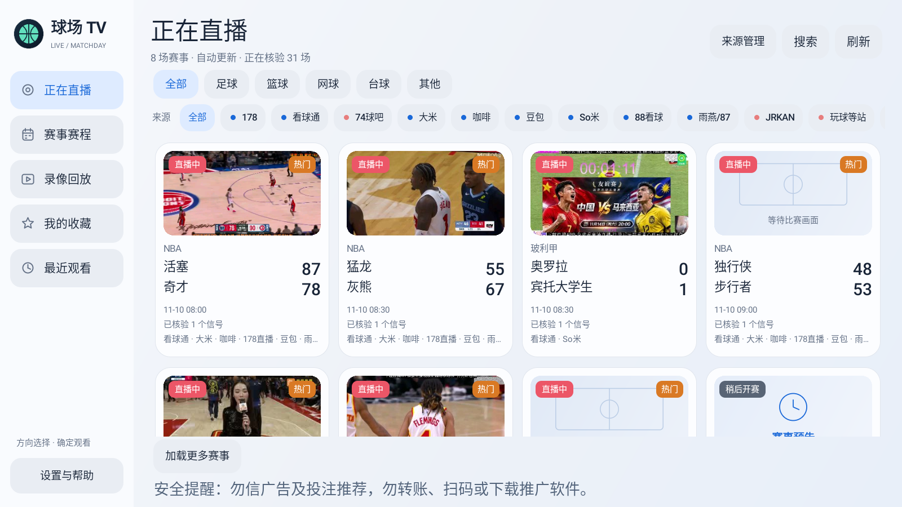

<p align="center"></p>
<h1 align="center">球场 TV</h1>
<p align="center">为电视大屏和遥控器设计的体育赛事聚合播放器</p>
<p align="center"><a href="https://github.com/laowangbian/balltv/releases/latest">下载最新版本</a> · <a href="#安装与更新">安装与更新</a> · <a href="#作者与交流">作者与交流</a> · <a href="#赞赏支持">赞赏支持</a></p>

不少民间体育直播网站以手机和电脑浏览器为主。到了电视上，网页按钮难用遥控器操作，赛事入口散落在各处，切换信号也经常要退出重找。球场 TV 把公开赛事目录、赛程与播放线路整理到同一个横屏界面，让你用遥控器找比赛、看赛程、切线路。旧电视和电视盒子可以选用专门优化的安卓四兼容版。

<p align="center"></p>
<p align="center"><sub>电视首页界面示例</sub></p>

## 主要功能

- **用遥控器找比赛**　大屏赛事卡片和清晰焦点，支持球队与联赛搜索，按日期、联赛和来源查看赛程。
- **同一场比赛集中查看**　合并可识别的重复赛程，将多个来源与线路放在一起。后台核验信号，卡片可显示实际视频抓帧。
- **播放与个人记录**　支持 HLS 和 FLV 播放、线路切换、收藏、最近观看及部分来源的录像回放。
- **按设备能力优化画面**　标准版提供可选的 AI 画质增强，按负载自动调整。安卓四兼容版减少后台取图和播放缓冲的开销。

## 安装与更新

| 版本 | 最低系统 | 适用场景 | 首发 APK |
| --- | --- | --- | --- |
| 标准版 | Android 5.0（API 21） | 常用电视和盒子，硬件满足条件时可尝试 AI 增强 | [下载标准版](https://github.com/laowangbian/balltv/releases/download/v0.15.5/BallTV-0.15.5-standard.apk) |
| 安卓四兼容版 | Android 4.4（API 19） | 旧电视与低配置盒子，优先降低资源占用 | [下载兼容版](https://github.com/laowangbian/balltv/releases/download/v0.15.5/BallTV-0.15.5-android4.apk) |

从 [GitHub Releases](https://github.com/laowangbian/balltv/releases/latest) 下载对应 APK，传到电视上安装。同包名、同签名的旧版本可覆盖安装，保留设置和收藏。

应用内进入 **设置与帮助 → 检查更新**。发现新版本后，可下载对应 APK，应用校验文件和签名，再打开系统安装器。若电视无法稳定访问 GitHub，可打开[夸克网盘备用入口](https://pan.quark.cn/s/4353e196c729)，按网盘中实际提供的版本手动下载并覆盖安装。

## 使用说明与安全

球场 TV 只做技术聚合，整理第三方站点公开提供的赛事目录和播放入口。项目不运营直播服务、不托管赛事节目，也不提供绕过登录、付费或 DRM 的功能。节目内容、播出权限和可用性由各来源及相关权利方决定。使用时请遵守所在地法规和相关服务规则，尊重赛事版权。

第三方信号可能变更、下线或夹带广告。本应用不提供投注服务。请勿根据直播画面中的广告或投注推广转账、扫码或安装其他软件。作者的交流和赞赏二维码可在应用设置中查看。

## 作者与交流

**老网编** · [微博「老网编自留地」](https://weibo.com/u/1985414793) · [知乎「老网编」](https://www.zhihu.com/people/baigh)

可在 **设置与帮助 → 关于与交流 → 微信与交流分享群** 扫码加微信，备注「球场 TV」申请加入交流群。扫码加不上时，可以搜索 `wangbianlaole`。遇到问题也可在 [Issues](https://github.com/laowangbian/balltv/issues) 反馈电视型号、Android 版本和复现步骤。

## 赞赏支持

如果球场 TV 对你有帮助，可以用微信扫码自愿赞赏。应用内入口为 **设置与帮助 → 赞赏支持**。

<p align="center"></p>

## 从源码构建

使用 JDK 17 和 Android SDK 34。两个版本各有独立的 Gradle 项目，共用 `shared/` 中的更新和作者信息界面。

```sh
./standard/gradlew -p standard assembleRelease testDebugUnitTest lintDebug
./android4/gradlew -p android4 assembleRelease testDebugUnitTest lintDebug
```

Windows 下使用对应目录的 `gradlew.bat`。自建 APK 需自行签名。各第三方组件的许可证和声明在 `standard/third-party/` 与 `android4/third-party/`。
